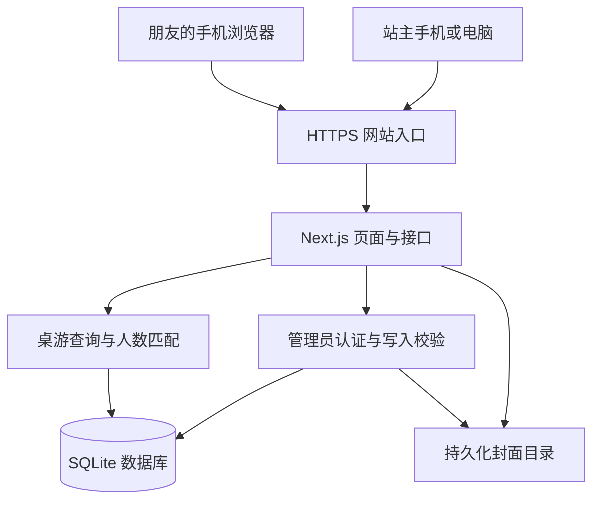

# happy-game 概要设计

版本：v1.0；日期：2026-10-10；实现更新：2026-10-11。本文为首期实施基线，代码与运行状态统一见 README，设计目标不代表已完成线上验证。

## 1. 产品定位与范围

建设一个手机端优先的个人桌游收藏站：让朋友通过链接欣赏已有桌游、了解怎么玩，并快速找到适合当前人数的游戏。

**已确认的需求：**

- 收藏由站主统一维护，访客免注册、免登录浏览；管理员登录后维护资料。
- 手机浏览器通过链接访问，首页突出艺术画廊，同时提供列表与人数选游入口。
- 手工录入桌游、上传封面；维护简介、支持人数、多个最佳人数、时长和类型标签，详细玩法选填。
- 输入人数，展示全部匹配游戏，最佳人数匹配优先；推荐细节可后续调整。
- 首期面向几百款以内的个人收藏和朋友小范围使用。

**首期边界：**“组局”落为“按人数选游”，不建设活动、报名、邀请或成员管理；不建设多用户收藏、评论评分、购买交易、自动抓取资料或 AI 推荐。

本文中的技术选型、路由、分页、字段必填规则、视觉细节和验收标准是为完成设计确定的默认方案，可在开发中依据实际情况修订，不代表已有实现或线上验证结果。

## 2. 页面与核心流程

| 页面       | 路由                                         | 主要内容与操作                                                   |
| ---------- | -------------------------------------------- | ---------------------------------------------------------------- |
| 艺术画廊   | `/`                                          | 收藏数量、人数选游入口、封面网格、名称与人数时长摘要；可切换列表 |
| 桌游列表   | `/games`                                     | 紧凑列表、名称搜索、人数筛选、结果数量；进入桌游详情             |
| 桌游详情   | `/games/[id]`                                | 完整封面、简介、支持与最佳人数、时长、标签、玩法介绍             |
| 人数选游   | `/pick?players=5`                            | 人数输入、推荐结果、匹配原因；修改人数后更新结果                 |
| 管理登录   | `/admin/login`                               | 站主账户登录、错误提示                                           |
| 收藏管理   | `/admin/games`                               | 查找、新增、编辑、删除收藏、退出登录                             |
| 录入与编辑 | `/admin/games/new`、`/admin/games/[id]/edit` | 分区表单、封面预览、校验、保存与返回                             |

浏览流程：打开链接 → 画廊或列表 → 查看详情 → 返回原列表位置。

选游流程：点击“几个人玩？” → 输入正整数人数 → 查看匹配游戏 → 打开详情；人数保留在 URL 中，结果页可以直接分享。未输入人数时展示输入提示，不默认替用户选定人数。

维护流程：登录 → 填写基本资料与封面 → 保存 → 回到管理列表；新增与编辑使用同一套表单和校验规则。删除前展示桌游名称并确认；提交失败保留已填写内容。

## 3. 手机端与艺术展示

- 默认采用浅色画廊风格：留白、中性色背景、低干扰边框，封面成为视觉主体；颜色与字体作为视觉默认值，后续可调整。
- 首页展示品牌与收藏数量，不加入大幅宣传轮播；“按人数选游”保持明显，主要导航为“画廊 / 列表 / 选游”。
- 手机端默认两列封面网格，极窄屏退为单列；封面区域保持统一比例，图片完整展示，避免切掉标题与原画。详情页提供更大尺寸封面。
- 卡片显示名称、支持人数和时长；选游结果增加“最佳人数匹配”或“支持该人数”标识。
- 列表采用缩略图与信息行；名称搜索和人数筛选组合生效，画廊与列表共享数据及筛选规则。
- 手机画廊与列表的搜索筛选默认收起，点击后展开；存在筛选条件时保持展开，将首屏空间优先留给收藏封面。
- 默认每页 24 款，通过“加载更多”继续浏览；筛选条件写入 URL，返回详情前的页面时恢复筛选与滚动位置。
- 点击区域至少 44 CSS 像素；提供输入标签、可见焦点、足够文字对比度和图片替代文本，不能只靠颜色表达匹配状态。
- 封面压缩、生成缩略图并延迟加载非首屏图片；图片失败显示占位，加载、空收藏、无匹配、保存失败分别给出明确提示。

## 4. 技术架构

采用同一代码库中的单体应用，页面、服务端接口和业务规则共同部署。浏览器不直接接触数据库、磁盘路径或管理员凭据。



| 部分         | 默认方案                                | 选择理由                                       |
| ------------ | --------------------------------------- | ---------------------------------------------- |
| 应用框架     | Next.js App Router + React + TypeScript | 页面与接口使用同一项目，减少独立部署和接口协调 |
| 样式         | CSS Modules + 全局设计变量              | 集中控制画廊视觉，保持页面样式局部隔离         |
| 数据库       | SQLite + `better-sqlite3`，参数化 SQL   | 单管理员写入、数据量小；无需单独运维数据库服务 |
| 图片         | 本地持久化目录，服务端生成缩略图        | 与单实例部署一致，首期无需引入外部存储服务     |
| 质量检查     | ESLint、Prettier、Vitest、Playwright    | 分别覆盖规范、核心规则和手机端关键流程         |
| 包管理与部署 | npm；单个 Node.js 应用实例，Docker 封装 | 锁定依赖，统一运行环境与数据卷配置             |

这是根据项目规模作出的设计选择。Next.js 官方提供 [Route Handlers](https://nextjs.org/docs/app/getting-started/route-handlers)、[CSS Modules](https://nextjs.org/docs/app/getting-started/css) 和 [Node.js / Docker 自托管](https://nextjs.org/docs/app/guides/self-hosting) 能力；SQLite 官方说明其适合网站后端，同时提示高并发写入场景更适合客户端／服务端数据库。参见 [SQLite 适用场景](https://www.sqlite.org/whentouse.html) 与 [better-sqlite3 官方说明](https://github.com/WiseLibs/better-sqlite3)。

服务端页面直接调用数据访问模块，避免在服务端绕行自身 HTTP 接口；浏览器交互通过同源接口完成。首期查询按请求读取最新数据，不引入跨请求业务缓存，保存成功后的首次查询即能看到新内容。数据库和上传接口使用 Node.js 运行环境。

## 5. 数据模型与约束

### 5.1 桌游 `games`

一条记录代表收藏中的一个桌游条目。首期不管理副本数量或版本关系，独立游玩的版本可作为独立条目录入。

| 字段                        | 含义           | 规则                                                              |
| --------------------------- | -------------- | ----------------------------------------------------------------- |
| `id`                        | 稳定标识       | 服务端生成 UUID，编辑名称不改变详情链接                           |
| `name`                      | 名称           | 必填，去除首尾空格；允许同名条目                                  |
| `summary`                   | 简介           | 必填，适合手机快速阅读的短文本                                    |
| `coverKey`                  | 封面存储标识   | 保存时必填；存储相对标识，不接收客户端文件路径                    |
| `minPlayers` / `maxPlayers` | 支持人数       | 必填正整数，最少不大于最多                                        |
| `bestPlayerCounts`          | 最佳人数       | 去重整数数组，例如 `[4, 5]`，每项必须在支持范围内；未知时允许为空 |
| `durationMinutes`           | 预计单局时长   | 必填正整数分钟，首期填写代表值                                    |
| `tags`                      | 类型标签       | 去空白、去重的字符串数组，可为空；例如“合作”“推理”                |
| `description`               | 详细玩法       | 选填 Markdown；禁用原始 HTML，渲染时过滤不安全链接                |
| `createdAt` / `updatedAt`   | 创建与修改时间 | 服务端生成，统一保存 UTC 时间                                     |

人数支持范围按连续区间处理；如果实际只有特定人数可玩，首期在详情说明，正式扩展规则前不要用最佳人数字段替代支持人数约束。最佳人数和标签以 JSON 文本存储，由服务端校验；首期无需额外关联表。

### 5.2 管理员会话 `admin_sessions`

仅保存随机会话令牌的哈希、创建时间与过期时间。管理员账号及密码哈希通过服务端环境配置提供，不建设注册、用户表或权限角色表。

所有 `games` 记录默认属于站主已拥有的收藏；删除记录即移出收藏展示与推荐。首期没有草稿或发布流程，管理员保存即对访客可见。

## 6. 人数选游规则

规则只依赖已录入资料，服务端统一计算，画廊筛选和独立选游页复用同一查询逻辑。

1. 校验输入为正整数 `playerCount`；空值显示输入引导，非法值返回字段错误。
2. 筛选 `minPlayers <= playerCount <= maxPlayers` 的桌游。
3. 将 `bestPlayerCounts` 包含该人数的桌游排在前面，其余匹配桌游排在后面。
4. 同一组按录入时间倒序、`id` 升序稳定排序；分页在排序后进行。
5. 每项返回匹配原因：`best` 对应“最佳人数匹配”，`supported` 对应“支持该人数”。

例如输入 5 人：支持 2～6 人且最佳为 `[4, 5]` 的游戏排在支持 3～6 人、最佳为 `[4]` 的游戏之前；最多支持 4 人的游戏不会出现。未填写最佳人数的游戏仍可以按支持范围匹配。

结果为空时展示“收藏中暂无适合 5 人的桌游”，提供“调整人数”和“查看全部收藏”入口。首期不拆桌、不猜测最佳人数、不计算综合推荐分，也不按标签或时长加权。

## 7. 接口与权限

| 接口                        | 权限       | 用途                                                              |
| --------------------------- | ---------- | ----------------------------------------------------------------- |
| `GET /api/games`            | 公开       | 支持 `q`、`players`、`page`；分页返回桌游摘要、结果总数和匹配原因 |
| `GET /api/games/[id]`       | 公开       | 返回桌游完整资料；记录不存在时返回 404                            |
| `GET /media/[key]`          | 公开       | 按合法标识读取封面或缩略图                                        |
| `POST /api/games`           | 管理员     | 提交表单和封面，创建收藏                                          |
| `PATCH /api/games/[id]`     | 管理员     | 修改资料，可替换封面                                              |
| `DELETE /api/games/[id]`    | 管理员     | 删除收藏记录                                                      |
| `POST /api/admin/session`   | 公开，限速 | 校验管理员凭据并建立会话                                          |
| `DELETE /api/admin/session` | 管理员     | 注销当前会话并清除 Cookie                                         |

写接口在服务端逐次验证会话和请求来源；隐藏管理按钮不能替代鉴权。会话通过 `HttpOnly`、生产环境 `Secure`、`SameSite` Cookie 传递，默认 7 天过期；注销删除服务端会话记录。认证实现遵循 [Next.js 官方认证指南](https://nextjs.org/docs/app/guides/authentication)，避免自行设计密码散列算法。

创建与更新使用 `multipart/form-data`，一次提交资料及封面，避免引入独立上传草稿流程。接受 JPEG、PNG、WebP，默认限制 5 MB 和 2000 万像素，验证真实格式并重新编码，去除元数据；存储文件名由服务端生成。处理失败清理本次新文件；替换封面在数据库保存成功后清理旧文件，清理失败记录日志，不撤销已保存资料。

查询与写入均使用参数化 SQL；分页和字段长度在服务端限制。错误响应包含稳定错误码、中文提示及必要的字段错误：400 为输入无效，401 为未登录或会话失效，403 为来源检查失败，404 为条目不存在，429 为登录过频，500 为服务异常。响应和日志不泄漏密码、会话令牌或服务器绝对路径。

## 8. 代码组织与部署

```text
src/
  app/                 # 页面、Route Handlers 与页面级状态
  features/games/      # 桌游表单、卡片、校验及人数匹配规则
  lib/                 # 数据访问、认证、图片处理和存储
public/                # 应用图标等随代码发布的静态资源
db/migrations/         # 按顺序执行的数据库结构变更
tests/unit/            # 推荐与校验测试
tests/e2e/             # 浏览、选游与管理员维护测试
docs/                  # 概要设计与后续必要设计文档
```

部署默认使用一台具有持久磁盘的服务器：HTTPS 入口 → 一个 Next.js 实例。数据库放在 `/data/happy-game.sqlite`，封面放在 `/data/uploads/`；二者由持久数据卷承载，不写入镜像、Git 或项目 `public/`。代码更新不覆盖收藏与图片。

每天及数据库迁移前备份数据库与其引用的图片，至少保留最近 7 份；利用 SQLite 备份机制取得一致快照，避免运行中仅复制主数据库文件。备份副本放在独立存储，覆盖图片的一致性，并在首次上线前实际验证恢复。单管理员场景可在备份过程中短暂停止写入。

该方案要求单实例和持久磁盘；无持久磁盘的函数运行环境、多副本部署需要改用外部数据库与对象存储，不能直接复用本地文件方案。服务器、域名与依赖版本在实施时选定，不需要为本概要设计继续追问。

## 9. 实施顺序与验收

| 阶段          | 交付                                       | 验证重点                                             |
| ------------- | ------------------------------------------ | ---------------------------------------------------- |
| 1. 可运行骨架 | 框架、样式变量、数据库迁移、环境示例与脚本 | 本地启动、静态检查、类型检查、生产构建通过           |
| 2. 收藏维护   | 管理员登录、桌游录入编辑删除、封面持久化   | 访客写入被拒绝，非法表单不可保存，重启数据不丢失     |
| 3. 收藏展示   | 画廊、列表、详情、搜索、分页               | 同一条目各视图一致，手机浏览流畅，详情返回保留位置   |
| 4. 人数选游   | 人数输入、筛选、最佳优先、匹配原因与空状态 | 上下界正确，最佳人数为空可匹配，结果无遗漏且排序稳定 |
| 5. 上线准备   | HTTPS、数据卷、备份恢复、真实手机检查      | 部署更新保留数据，恢复成功，链接可在手机中打开       |

首期验收标准：

- 320～430 CSS 像素宽度的页面无横向溢出；真实手机浏览器验证画廊、列表、详情、人数输入和管理表单，并检查微信群内打开链接的可用性。
- 单元测试覆盖人数上下界、非法输入、最佳人数优先、缺失最佳人数、空结果，以及表单约束；端到端测试覆盖访客浏览、按人数选游、管理员完整维护流程与越权请求。
- 新增、修改、删除后，访客下一次查询看到一致结果；重新部署后资料和图片仍存在。
- 使用约 300 款测试条目验证分页、图片加载和查询。手机端关键体验目标为首屏 LCP 不高于 2.5 秒，实施时记录测试设备与网络条件；这是验收目标，不是当前性能结论。
- 安装、开发、测试、静态检查和构建命令统一维护在 README；本文中的验收目标不等同于已完成的验证结果。

## 10. 后续调整边界

人数推荐细节是用户明确预留的后续调整点，先保持筛选和排序规则可读、可测试。时长与标签筛选、更多展示图片、资料导入等需求出现时再评估，不提前建立插件、评分引擎或通用工作流。

需求或设计发生变化时，先更新本文及相关仓库指南，再修改实现；本文持续作为唯一概要设计入口。
